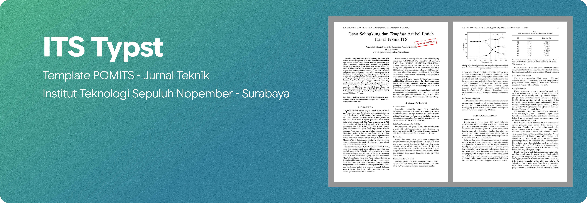

<div align="center">
  <h1>Template POMITS — Jurnal Teknik ITS</h1>

  <p>
    
    
    
    
  </p>

  <p>Template <a href="https://typst.app">Typst</a> untuk naskah publikasi ilmiah <strong>Jurnal Teknik ITS (POMITS)</strong>. Format mengikuti berkas resmi <code>references/PUBLIKASI_TEKNIK.doc</code>: kertas <strong>A4</strong>, margin kiri/kanan 1,65 cm dan atas/bawah 1,78 cm, dua kolom, huruf Times New Roman 10 pt.</p>
</div>

> **Perhatian — format pengumpulan naskah.** Portal e-jurnal ITS (ejurnal.its.ac.id) pada umumnya menerima naskah dalam format **Microsoft Word (.doc/.docx)**, bukan PDF, sementara Typst belum punya fitur ekspor langsung ke .docx. PDF hasil `typst compile` di sini berguna untuk mengecek tata letak (margin, dua kolom, penomoran gambar/tabel/persamaan) — bukan berkas akhir yang dikumpulkan. Setelah format dirasa pas, salin ulang isi naskah ke berkas Word resmi (`references/PUBLIKASI_TEKNIK.doc`) sebelum submit. Sebagai pengingat, halaman pertama otomatis diberi cap "FORMAT PREVIEW ONLY" (lihat `content/00-identitas.typ`) — hapus baris `#place(...)` di sana kalau suatu saat template ini sudah bisa dikumpulkan langsung dalam bentuk PDF.

## Yang perlu dipasang

| Alat | Keterangan |
|---|---|
| [Typst](https://github.com/typst/typst) 0.13+ | mesin penyusun dokumen (`typst --version` untuk cek) |
| Font Times New Roman | biasanya sudah ada di Windows |
| Koneksi internet (sekali saja) | compile pertama akan mengunduh paket `@preview/droplet` untuk drop cap |
| VS Code + ekstensi **Tinymist** | opsional, untuk pratinjau langsung |

## Cara pakai singkat

1. Buka `data.yaml`, ganti judul, daftar penulis, afiliasi, dan e-mail dengan data asli.
2. Isi `content/01-abstrak.typ` (abstrak & kata kunci) dan `content/chapters/01-bab1.typ` sampai `05-bab5.typ`.
3. Jalankan:

   ```bash
   typst compile main.typ      # sekali jadi main.pdf
   typst watch main.typ        # otomatis tiap kali file disimpan
   ```

4. Buka `main.pdf` untuk pratinjau — ingat, ini pratinjau format, bukan berkas yang dikumpulkan.

## Isi folder

```
main.typ                      perakit dokumen (AUTO — jangan diubah)
data.yaml                     judul, daftar penulis, afiliasi, e-mail
daftar-pustaka.bib            sumber sitasi (BibTeX)
content/                      bagian-bagian naskah
  00-identitas.typ              judul, penulis, afiliasi, cap "format preview"
  01-abstrak.typ                 WAJIB EDIT — abstrak & kata kunci
  02-lampiran.typ                 lampiran (opsional)
  03-ucapan-terima-kasih.typ      ucapan terima kasih (opsional)
  04-daftar-pustaka.typ           otomatis dari daftar-pustaka.bib
  chapters/
    01-bab1.typ                    I. Pendahuluan — WAJIB EDIT
    02-bab2.typ                    II. Uraian Penelitian — WAJIB EDIT
    03-bab3.typ                    III. Petunjuk Tambahan (contoh gambar/tabel/persamaan)
    04-bab4.typ                    IV. Prinsip-prinsip Publikasi
    05-bab5.typ                    V. Kesimpulan/Ringkasan — WAJIB EDIT
template/                     page setup, tipografi, running header, penomoran heading,
                               drop cap (AUTO — sebaiknya tidak diubah)
assets/                       gambar & aset visual, termasuk cap pengingat
references/                   berkas Word/PDF resmi sebagai acuan & format pengumpulan akhir
```

`main.typ`, `template/lib.typ`, dan `template/template.typ` ditandai **AUTO** langsung di baris
komentar paling atas — berkas-berkas itu yang mengatur tata letak dan sebaiknya tidak disentuh.
Berkas lain di `content/` bebas diisi sesuai naskah.

## Pola penulisan

Heading pakai sintaks native Typst, penomoran otomatis (I., II. … untuk level 1; A., B. …
untuk level 2):

```typst
= Judul Bab
== Subbagian
```

Bagian tanpa nomor (Lampiran, Daftar Pustaka, dll.) pakai:

```typst
#heading(level: 1, numbering: none)[Lampiran]
```

Menyisipkan gambar:

```typst
#figure(
  image("../../assets/nama-gambar.png", width: 100%),
  caption: [Deskripsi gambar, tampilkan signifikansinya di sini.],
) <label-gambar>
```

Path gambar dihitung dari lokasi file `.typ` itu sendiri — dari `content/chapters/`
diawali `../../assets/...`.

Menyisipkan tabel:

```typst
#figure(
  kind: table,
  caption: figure.caption(position: top)[Judul tabel],
  table(
    columns: (1fr, 1fr),
    table.header[*Kolom A*][*Kolom B*],
    [Baris 1], [Nilai 1],
  ),
) <label-tabel>
```

Menyisipkan persamaan (bernomor otomatis, rata kanan):

```typst
$ J(U,V) = sum_(k=1)^N sum_(i=1)^c (u_(i k))^m D(x_k, v_i)^2 $ <eq:objective>
```

Menyitasi pustaka: tulis `@kunci-sitasi` di dalam kalimat, kuncinya diambil dari
`daftar-pustaka.bib`. Daftar Pustaka tersusun otomatis bergaya IEEE di
`content/04-daftar-pustaka.typ`.

## Urutan bagian naskah

Identitas (judul, penulis, afiliasi) → Abstrak & Kata Kunci → Bab I–V → Lampiran →
Ucapan Terima Kasih → Daftar Pustaka. Nomor halaman arab berjalan terus dari halaman 1,
ditampilkan di running header bersama nama jurnal dan volume/nomor/tahun — atur lewat
`#show: template.with(vol: "X", no: "Y", year: "TAHUN")` di `main.typ`.

## Menambah atau mengurangi bab

Buat berkas baru di `content/chapters/`, lalu daftarkan di `main.typ`:

```typst
#include "content/chapters/06-bab6.typ"
```

Nomor bab dan nomor gambar/tabel/persamaan di dalamnya menyesuaikan sendiri.

## Kontributor

[](https://github.com/ITS-Typst/template-POMITS/graphs/contributors)

## Lisensi

Dirilis di bawah lisensi **MIT** — lihat [LICENSE](LICENSE) untuk teks lengkapnya. Bebas digunakan, dikembangkan, dan disesuaikan dengan kebutuhan.
